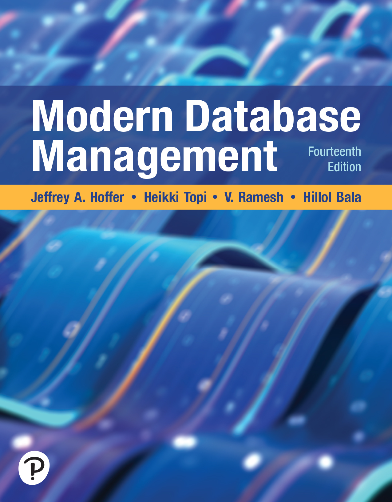
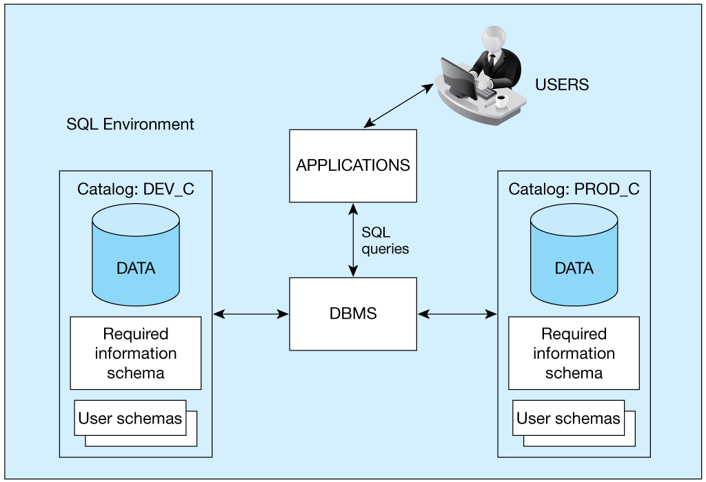
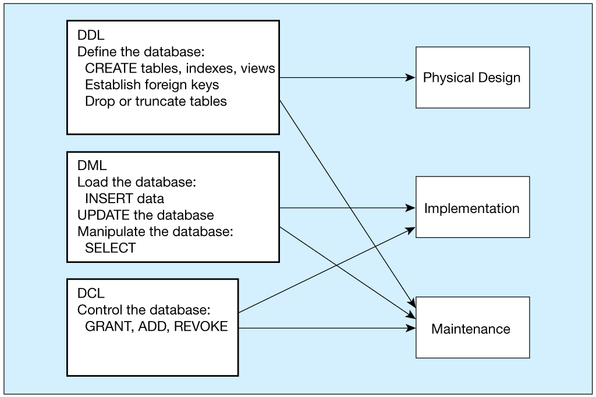
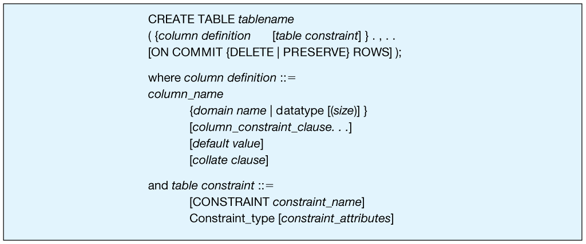
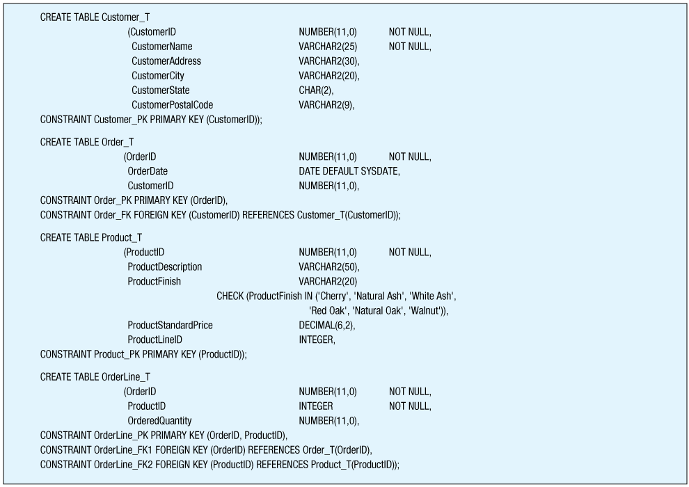
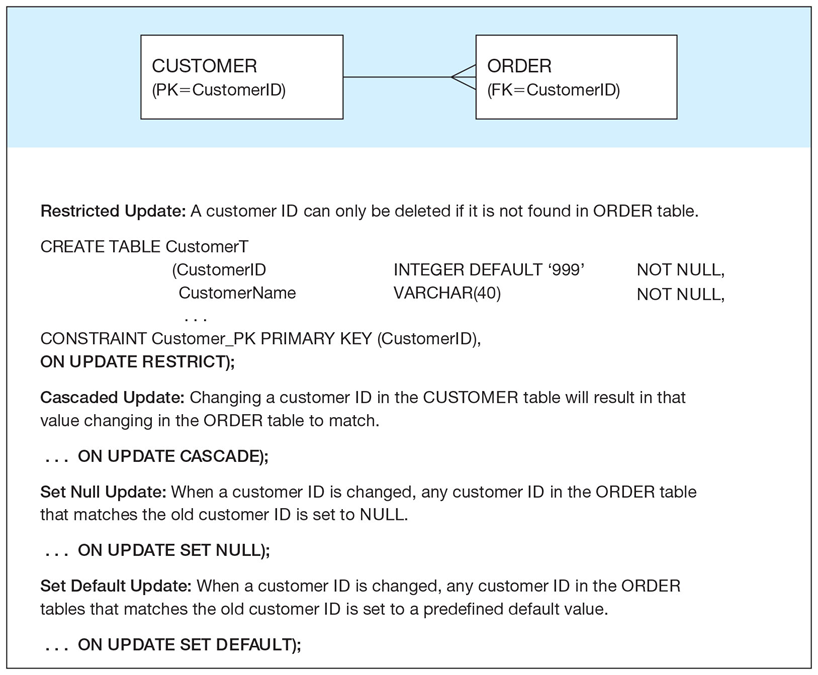
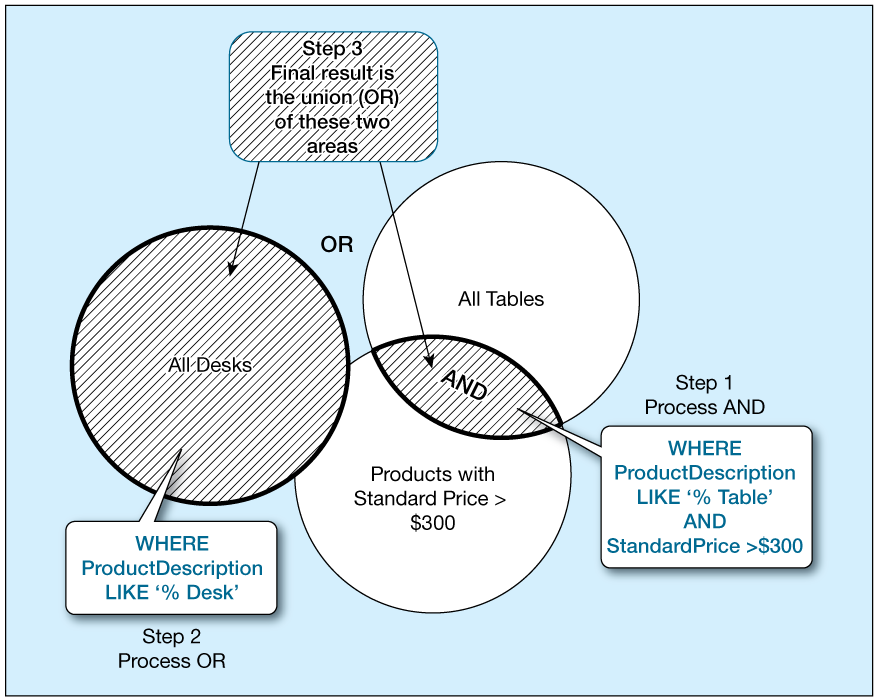
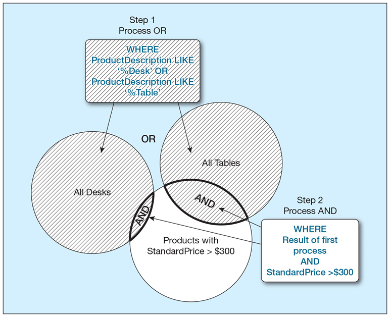
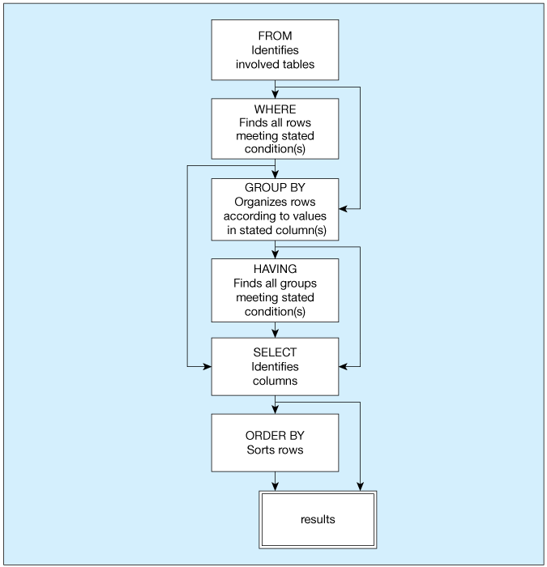

# Chapter 5: Introduction to SQL

**Source:** [mis-600-chapter-05-slides.pptx](mis-600-chapter-05-slides.pptx) · 44 slides.

**Coverage:** SQL history and standards; DDL, DML, and DCL; data types; table creation and referential integrity; INSERT, DELETE, UPDATE, MERGE, and indexes; SELECT, functions, Boolean filters, DISTINCT, IN, sorting, grouping, and HAVING.

## About this copy

Slide-by-slide text extraction for reading and searching. The original deck is authoritative. Slide numbers match the original; PDF page numbers match slide numbers. Repeated PDF headers/footers and decorative letter spacing are omitted. PDF diagrams, image-only text, table layout, underlining, and cardinality symbols remain in the original; follow the source link on each slide to inspect them. Source wording and examples are retained, including graduate-student instructions (the course README identifies this enrollment as undergraduate).

### Source SQL issues

This is the Pearson textbook deck, not the instructor-formatted deck used for Chapters 1–4. Its SQL text is preserved as printed rather than treated as runnable code. The deck uses Oracle-specific syntax and spaces in several example identifiers.

- Slide 19: the Product INSERT lists four columns but supplies five values.
- Slide 22: the MERGE example is incomplete.
- Slide 16: the figure explains referential update actions, but its SQL shorthand places ON UPDATE beside a primary-key definition; these actions belong on the referencing foreign-key constraint, with support varying by DBMS.
- Slide 26: the alias example has an incomplete opening quote and filters on a SELECT alias in WHERE, which is not portable SQL.
- Slide 35: the first example uses 200–300; the BETWEEN example prints 20–300, so these filters are not equivalent.
- Slides 14 and 28 include Oracle-specific types/functions. Check the DB Fiddle engine before running examples.

Embedded slide images are reproduced below their extracted text. They retain figure content that is not available as text.

## Slide 1: Modern Database Management

[Original slide](mis-600-chapter-05-slides.pptx)

Fourteenth Edition  
Chapter 5  
Introduction to S Q L  
Copyright © 2026, 2022, 2018 Pearson Education, Inc. All Rights Reserved  

## Slide 2: Learning Objectives

[Original slide](mis-600-chapter-05-slides.pptx)

5.1 Concisely define chapter key terms  
5.2 Interpret the history and role of S Q L in database development  
5.3 Define and implement a database using the S Q L data definition language  
5.4 Establish referential integrity using S Q L  
5.5 Write single-table queries using S Q L commands  
5.6 Discuss the S Q L:1999 and S Q L:2016 standards  

## Slide 3: S Q L Overview

[Original slide](mis-600-chapter-05-slides.pptx)

Structured Query Language—often pronounced “Sequel”  
The standard for Relational Database Management Systems (R D B M S)  
R D B M S: A database management system that manages data as a collection of tables in which all relationships are represented by common values in related tables  

## Slide 4: History of S Q L

[Original slide](mis-600-chapter-05-slides.pptx)

1970—E. F. Codd develops relational database concept  
1974-79—System R with Sequel (later S Q L) created at I B M Research Lab  
1979—Oracle markets first relational D B with S Q L  
1981—S Q L/D S first available R D B M S system on D O S/V S E  
Others followed: I N G R E S (1981), I D M (1982), D G/S G L (1984), Sybase (1986)  
1986—A N S I S Q L standard released  
Major A N S I standard updates in 1989, 1992, 1999, 2003, 2006, 2008, 2011, 2016  
Today—S Q L is supported by most major database vendors  

## Slide 5: Original Purpose of S Q L Standard

[Original slide](mis-600-chapter-05-slides.pptx)

Specify syntax/semantics for data definition and manipulation  
Define data structures and basic operations  
Enable portability of database definition and application modules  
Specify minimal (level 1) and complete (level 2) standards  
Allow for later growth/enhancement to standard (referential integrity, transaction management, user-defined functions, extended join operations, national character sets)  

## Slide 6: Benefits of a Standardized Relational Language

[Original slide](mis-600-chapter-05-slides.pptx)

Reduced training costs  
Productivity  
Application portability  
Application longevity  
Reduced dependence on a single vendor  
Cross-system communication  

## Slide 7: S Q L Environment

[Original slide](mis-600-chapter-05-slides.pptx)

Catalog  
A set of schemas that constitute the description of a database  
Schema  
The structure that contains descriptions of objects created by a user (base tables, views, constraints)  
Data Definition Language (D D L)  
Commands that define a database, including creating, altering, and dropping tables and establishing constraints  
Data Manipulation Language (D M L)  
Commands that maintain and query a database  
Data Control Language (D C L)  
Commands that control a database, including administering privileges and committing data  

## Slide 8: Figure 5-1 A Simplified Schematic of a Typical S Q L Environment, as Described by the S Q L:2016 Standard

[Original slide](mis-600-chapter-05-slides.pptx)

## Slide 9: S Q L Data Types

[Original slide](mis-600-chapter-05-slides.pptx)

Strings  
CHARACTER (n), CHARACTER VARYING (n)  
Binary  
BINARY LARGE OBJECT (B L O B)  
Number  
NUMERIC (precision, scale), DECIMAL (p, s), INTEGER  
Temporal  
TIMESTAMP, TIMESTAMP WITH LOCAL TIME ZONE  
Boolean  
BOOLEAN  

## Slide 10: Figure 5-4 D D L, D M L, D C L, and the Database Development Process

[Original slide](mis-600-chapter-05-slides.pptx)

## Slide 11: S Q L Database Definition

[Original slide](mis-600-chapter-05-slides.pptx)

Major CREATE statements:  
CREATE SCHEMA—defines a portion of the database owned by a particular user  
CREATE TABLE—defines a new table and its columns  
CREATE VIEW—defines a logical table from one or more tables or views  
CREATE INDEX—creates a separate data structure   
Other CREATE statements: CHARACTER SET, COLLATION, TRANSLATION, ASSERTION, DOMAIN  

## Slide 12: Steps in Table Creation

[Original slide](mis-600-chapter-05-slides.pptx)

Identify data types for attributes  
Identify columns that can and cannot be null  
Identify columns that must be unique (candidate keys)  
Identify primary key–foreign key mates  
Determine default values  
Identify constraints on columns (domain specifications)  
Create the table and associated indexes  

## Slide 13: Figure 5-5 General Syntax of the CREATE TABLE Statement Used in Data Definition Language

[Original slide](mis-600-chapter-05-slides.pptx)

## Slide 14: Figure 5-6 S Q L Database Definition Commands for Pine Valley Furniture Company (Oracle 19c)

[Original slide](mis-600-chapter-05-slides.pptx)

## Slide 15: Creating Data Integrity Controls

[Original slide](mis-600-chapter-05-slides.pptx)

Referential integrity—means that a value in the matching column on the many side must correspond to a value in the primary key or be NULL  
The S Q L REFERENCES clause prevents a foreign key value from being added if it is not already a valid value in the referenced primary key column  

## Slide 16: Figure 5-7 Ensuring Data Integrity Through Updates

[Original slide](mis-600-chapter-05-slides.pptx)

Relational integrity is enforced via the primary-key to foreign-key match  

## Slide 17: Changing Table Definitions

[Original slide](mis-600-chapter-05-slides.pptx)

ALTER TABLE statement allows you to change column specifications:  
ALTER TABLE table_name alter_table_action;  
Table Actions:  
ADD [COLUMN] column_definition  
ALTER [COLUMN] column_name SET DEFAULT default-value  
Example (adding a new column with a default value):  
ALTER TABLE CUSTOMER_T ADD CustomerType VARCHAR2 (10) DEFAULT ‘Commercial’;  

## Slide 18: Removing Tables

[Original slide](mis-600-chapter-05-slides.pptx)

DROP TABLE statement allows you to remove tables from your schema:  
DROP TABLE Customer_T  

## Slide 19: INSERT Statement

[Original slide](mis-600-chapter-05-slides.pptx)

Inserting into a table:  
INSERT INTO Customer_T VALUES(001, ‘Contemporary Casuals’, ‘1355 S. Himes Blvd.’, ‘Gainesville’, ‘F L’, ‘32601’);  
Inserting a record that has some null attributes requires identifying the fields that actually get data:  
INSERT INTO Product_T (Product I D, Product Description, Product Finish, Product Standard Price)      VALUES (1, ‘End Table’, ‘Cherry’, 175, 8);  
Inserting from another table:  
INSERT INTO C a   Customer_T SELECT * FROM Customer_T      WHERE Customer State = ‘C A’;  

## Slide 20: DELETE Statement

[Original slide](mis-600-chapter-05-slides.pptx)

Delete certain rows  
DELETE FROM Customer_T WHERE CustomerState = ‘H I’;  
Delete all rows  
DELETE FROM Customer_T;  

## Slide 21: UPDATE Statement

[Original slide](mis-600-chapter-05-slides.pptx)

Modifies data in existing rows  
UPDATE Product_T SET Product Standard Price = 775    WHERE Product I D = 7;  

## Slide 22: MERGE Statement

[Original slide](mis-600-chapter-05-slides.pptx)

Makes it easier to update a table by allowing the combination of Insert and Update in one statement  
Useful for updating master tables with new data  
MERGE INTO Product_T AS PRODUSING(SELECT Product I D, Product Description, Product Finish, …...  

## Slide 23: Internal Schema Definition in R D B M Ss

[Original slide](mis-600-chapter-05-slides.pptx)

Control processing/storage efficiency:  
Choice of indexes  
File organizations for base tables  
File organizations for indexes  
Data clustering  
Statistics maintenance  
Creating indexes  
Speed up random/sequential access to base table data  
Example  
CREATE INDEX Name_I D X ON Customer_T(Customer Name);  
This makes an index for the CUSTOMER NAME field of the CUSTOMER_T table  

## Slide 24: SELECT Statement

[Original slide](mis-600-chapter-05-slides.pptx)

Used for queries on single or multiple tables  
Clauses of the SELECT statement:  
SELECT: List the columns (and expressions) to be returned from the query  
FROM: Indicate the table(s) or view(s) from which data will be obtained  
WHERE: Indicate the conditions under which a row will be included in the result  

## Slide 25: SELECT Example

[Original slide](mis-600-chapter-05-slides.pptx)

For example, find products with standard price less than $275  
SELECT Product Description, Product Standard Price    FROM Product_T 	  WHERE Product Standard Price < 275;  

## Slide 26: SELECT Example Using Alias

[Original slide](mis-600-chapter-05-slides.pptx)

Alias is an alternative column or table name  
SELECT CUST.Customer Name AS Name, CUST.Customer Address  
     FROM Customer_T AS Cust WHERE Name =        Home Furnishings’;  

## Slide 27: Using Expressions

[Original slide](mis-600-chapter-05-slides.pptx)

Expressions are mathematical manipulations of the data in the table  
Stored functions to manipulate the rows of data   
Mathematical manipulations constructed by using mathematical operations  

## Slide 28: Using Functions

[Original slide](mis-600-chapter-05-slides.pptx)

Type  
Examples  
Mathematical  
MIN, MAX, COUNT, SUM, ROUND (to round up a number to a specific number of decimal places), T R U N C (to truncate insignificant digits), and M O D (for modular arithmetic)  
String  
LOWER (to change to all lowercase), UPPER (to change to all capital letters), INIT CAP (to change to only an initial capital letter), CONCAT (to concatenate), SUBSTR (to isolate certain character positions), and COALESCE (finding the first not NULL values in a list of columns)  
Date  
NEXT_DAY (to compute the next date in sequence), ADD_MONTHS (to compute a date a given number of months before or after a given date), and MONTHS_BETWEEN (to compute the number of months between specified dates)  
Analytical  
TOP (find the top n values in a set, e.g., the top 5 customers by total annual sales)  

## Slide 29: SELECT Examples Using a Function

[Original slide](mis-600-chapter-05-slides.pptx)

How many different items were ordered on order number 1004?  
SELECT COUNT (*)     FROM Order Line_T         WHERE Order I D = 1004;  
Which orders have been placed since 10/24/2024?  
SELECT Order I D, Order Date     FROM Order_T  	     WHERE Order Date >’24-OCT-2024’;  
Display all customers that do not have a postal code.  
SELECT * FROM Customer_T    WHERE Customer Postal Code IS NULL  

## Slide 30: Using Boolean Operators

[Original slide](mis-600-chapter-05-slides.pptx)

Operator  
Result  
AND  
Joins two or more conditions and returns results only when all conditions are true.  
OR  
Joins two or more conditions and returns results when any conditions are true.  
NOT  
Negates an expression.  

## Slide 31: SELECT Example—Boolean Operators

[Original slide](mis-600-chapter-05-slides.pptx)

AND, OR, and NOT Operators for customizing conditions in WHERE clause  
SELECT Product Description, Product Finish,      Product Standard Price        FROM Product_T            WHERE Product Description LIKE ‘%Desk’                 OR Product Description LIKE ‘%Table’                 AND Product Standard Price > 300;  

## Slide 32: Figure 5-8 Boolean Query A Without the Use of Parentheses

[Original slide](mis-600-chapter-05-slides.pptx)

## Slide 33: SELECT Example–Boolean Operators

[Original slide](mis-600-chapter-05-slides.pptx)

SELECT Product Description, Product Finish, Product Standard Price  
     FROM Product_T  
         WHERE (Product Description LIKE ‘%Desk’  
               OR Product Description LIKE ‘%Table’)  
               AND Product Standard Price > 300;  

## Slide 34: Figure 5-9 Boolean Query B with Use of Parentheses

[Original slide](mis-600-chapter-05-slides.pptx)

## Slide 35: Using Ranges for Qualification

[Original slide](mis-600-chapter-05-slides.pptx)

SELECT Product Description, Product Standard Price    FROM Product_T          WHERE Product Standard Price > = 200 AND          Product Standard Price < = 300;  
SELECT Product Description, Product Standard Price    FROM Product_T         WHERE Product Standard Price BETWEEN 20          AND 300;  

## Slide 36: Using Distinct Values

[Original slide](mis-600-chapter-05-slides.pptx)

What are the unique combinations of order number and order quantity included in the Order Line table?  
SELECT DISTINCT Order I D, Ordered Quantity     FROM Order Line_T;  

## Slide 37: Using IN and NOT IN with Lists

[Original slide](mis-600-chapter-05-slides.pptx)

List all customers who live in warmer states  
SELECT Customer Name, Customer City, Customer State     FROM Customer_T          WHERE Customer State IN (‘F L’, ‘T X’, ‘C A’, ‘H I’);  

## Slide 38: Additional Clauses

[Original slide](mis-600-chapter-05-slides.pptx)

Clause  
Result  
ORDER BY  
Sorts the final results rows in ascending or descending order.  
GROUP BY  
Groups rows in an intermediate results table where the values in those rows are the same for one or more columns.  
HAVING  
Can only be used following a GROUP BY and acts as a secondary WHERE clause, returning only those groups that meet a specified condition.  

## Slide 39: Sorting Results: The ORDER BY Clause

[Original slide](mis-600-chapter-05-slides.pptx)

Sort the results first by STATE, and within a state by the CUSTOMER NAME  
SELECT Customer Name, Customer City, Customer State  
              FROM Customer_T  
                   WHERE Customer State IN (‘F L’, ‘T X’, ‘C A’, ‘H I’)  
                        ORDER BY Customer State, Customer Name;  

## Slide 40: Categorizing Results Using GROUP BY Clause (1 of 2)

[Original slide](mis-600-chapter-05-slides.pptx)

For use with aggregate functions  
Scalar aggregate: single value returned from S Q L query with aggregate function  
Vector aggregate: multiple values returned from S Q L query with aggregate function (via GROUP BY)  

## Slide 41: Categorizing Results Using GROUP BY Clause (2 of 2)

[Original slide](mis-600-chapter-05-slides.pptx)

Count the number of customers with addresses in each state to which we ship  
SELECT Customer State, COUNT (Customer State)  
     FROM Customer_T  
          GROUP BY Customer State  
               ORDER BY Customer State  

## Slide 42: Qualifying Results by Categories Using the HAVING Clause

[Original slide](mis-600-chapter-05-slides.pptx)

Find only states with more than one customer  
SELECT Customer State, COUNT (Customer State)  
       FROM Customer_T  
             GROUP BY Customer State  
             HAVING COUNT (Customer State) > 1;  

## Slide 43: Figure 5-10 S Q L Statement Processing Order

[Original slide](mis-600-chapter-05-slides.pptx)

**Figure reading:** The logical processing sequence is FROM → WHERE → GROUP BY → HAVING → SELECT → ORDER BY. The written SELECT syntax below uses a different order.

SELECT [ALL/DISTINCT] column_list  
FROM table list  
[WHERE conditional expression]  
[GROUP BY group_by_column_list]  
[HAVING conditional expression]  
[ORDER BY order_by_column_list]  
(based on van der Lans, 2006, p. 100)  

## Slide 44: Copyright

[Original slide](mis-600-chapter-05-slides.pptx)

This work is protected by United States copyright laws and is provided solely for the use of instructors in teaching their courses and assessing student learning. Dissemination or sale of any part of this work (including on the World Wide Web) will destroy the integrity of the work and is not permitted. The work and materials from it should never be made available to students except by instructors using the accompanying text in their classes. All recipients of this work are expected to abide by these restrictions and to honor the intended pedagogical purposes and the needs of other instructors who rely on these materials.  

