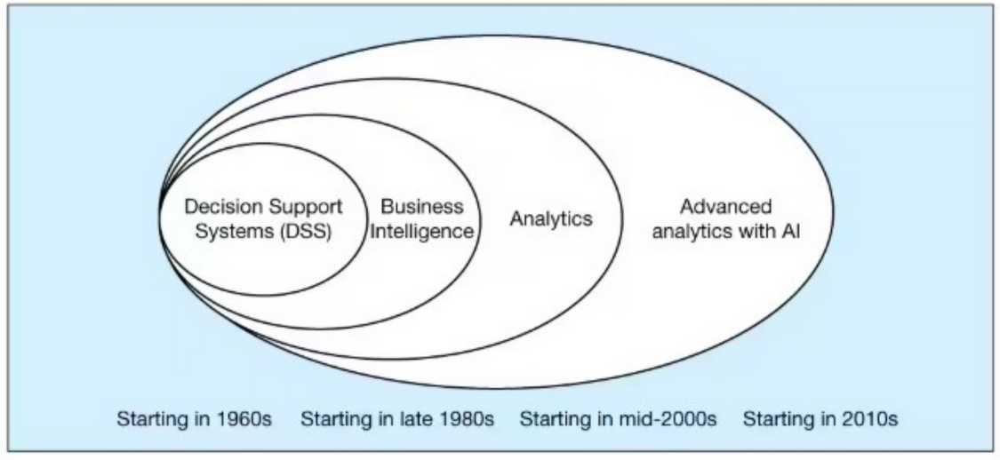
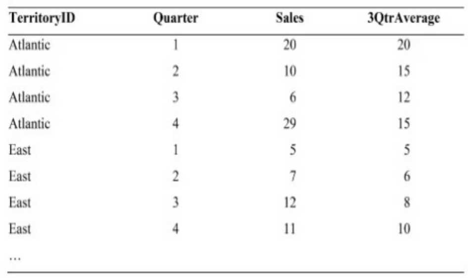
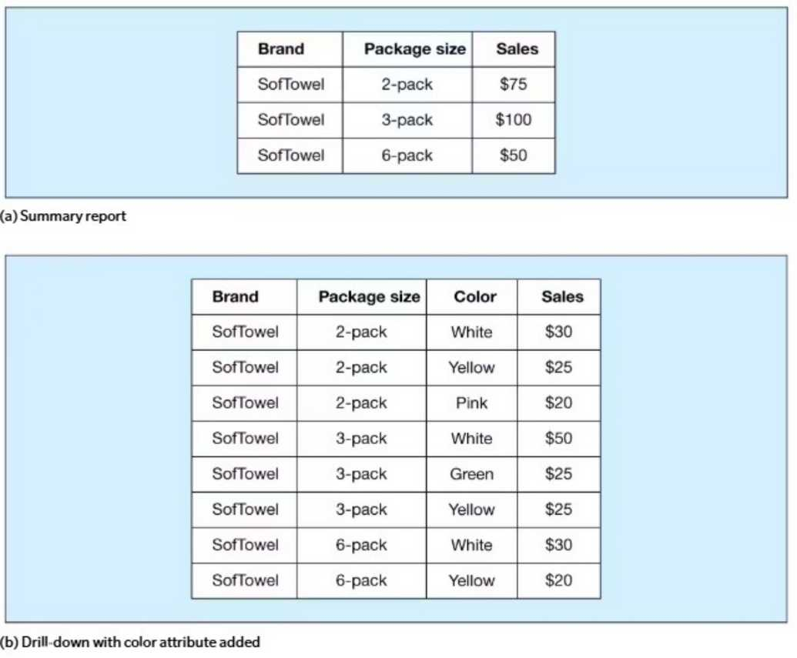
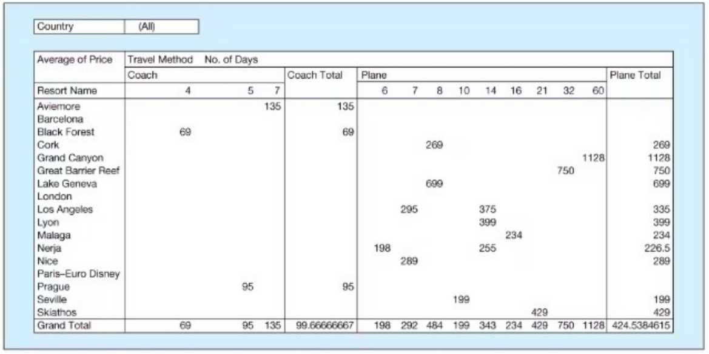
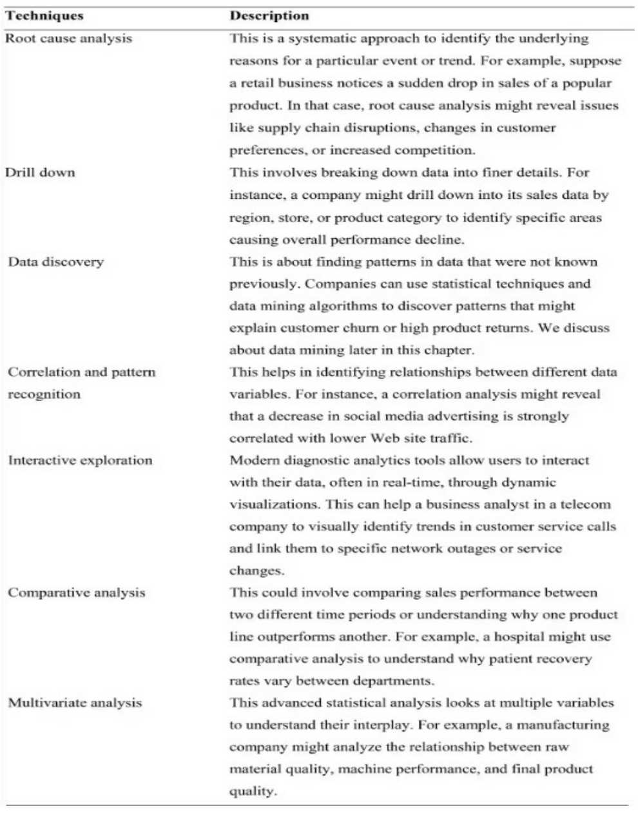
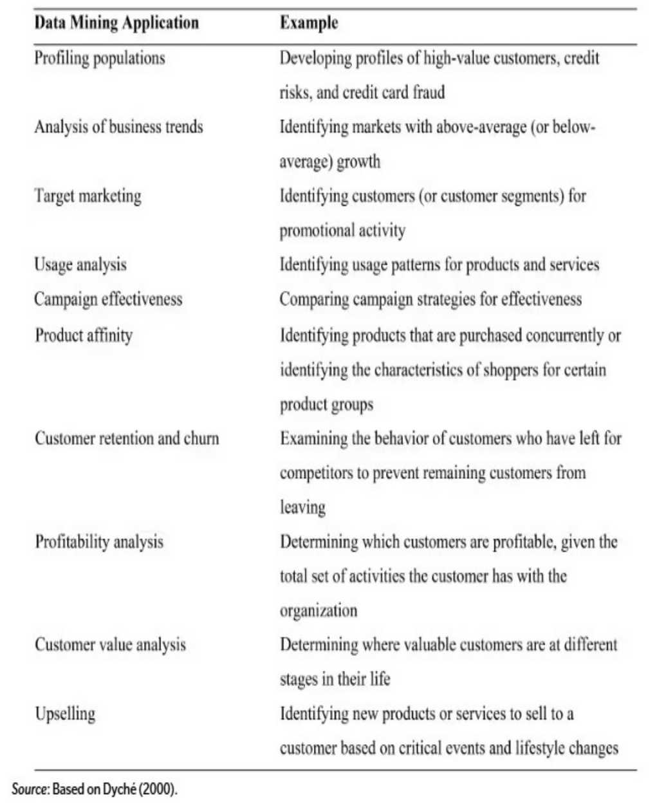
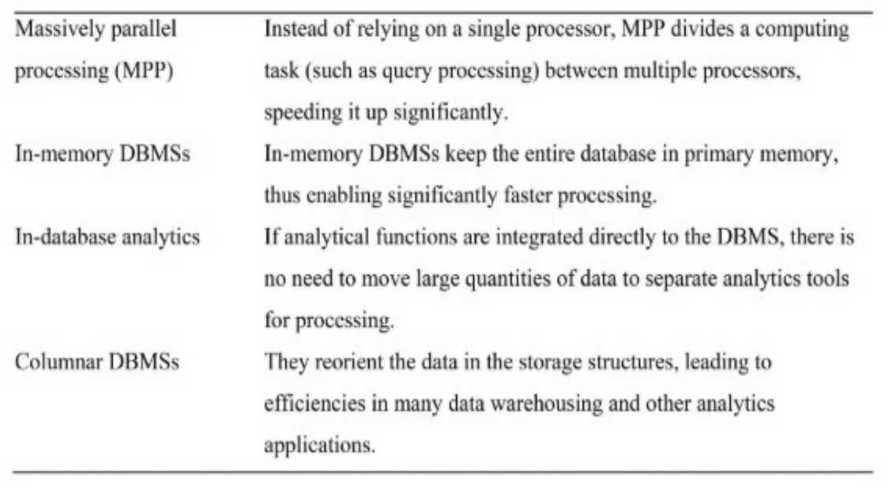
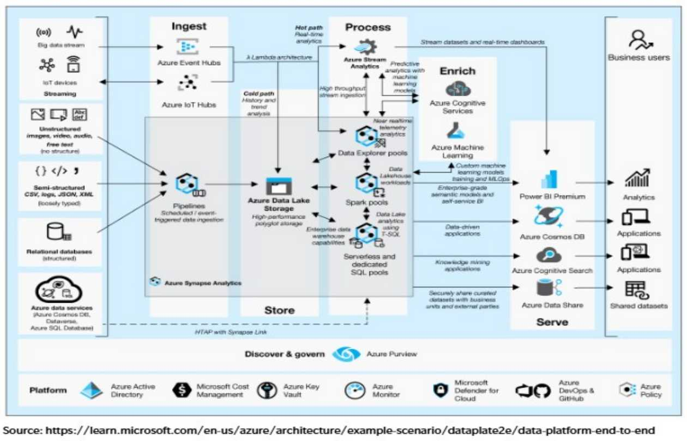
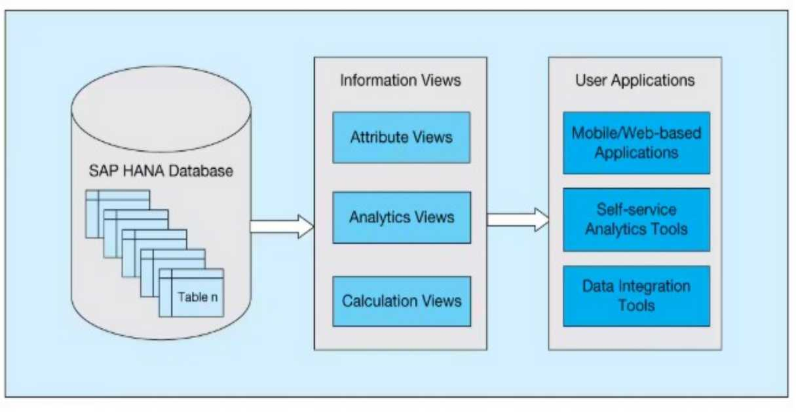
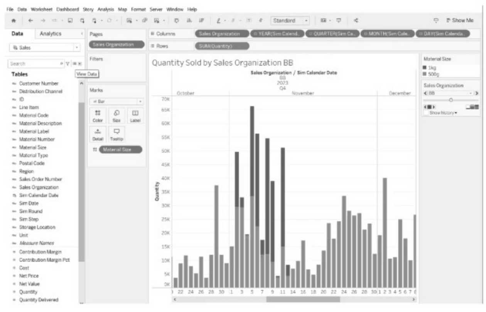

# Chapter 11: Analytics - From Data to Insights

**Source:** [Original HTML](mis-600-chapter-11-thoughts.html).

This copy retains the source text and figures for reading and searching. The original HTML is authoritative.

In this chapter, I walk you through how organizations move from storing data to actually getting value out of it. Everything we covered in the earlier chapters, the relational databases, the big data infrastructure, the data warehouses, all of that was plumbing. This chapter is where that plumbing pays off. I want you to finish reading this and come away with a clear sense of what analytics is, how it works inside organizations, and what the bigger implications are for society.

## What Analytics Actually Means

I define analytics as the systematic analysis and interpretation of data, typically using mathematical, statistical, and computational tools, to improve our understanding of a real world domain. That is a wide definition, and it is wide on purpose. In the early days we did not call it analytics. We called it Decision Support Systems, or DSS, a term Sprague used back in 1980 to describe systems that helped managers tackle problems that did not have a clear structure.

From DSS the field grew into what Gartner and Forrester called business intelligence, which Forrester defined as a set of methodologies, processes, architectures, and technologies that turn raw data into useful information. In recent years, the word analytics took over as the umbrella term. It now covers the techniques, the infrastructure, the data sources, the cleaning processes, and the user interfaces. Figure 11-1 shows how this evolution unfolded from the 1960s through today.



Figure 11-1: Moving from decision support systems to analytics

A few other terms come up often in this space, and I want you to keep them straight. Data science is the overarching field that covers the entire lifecycle of data. A data scientist has the skills to combine math, statistics, computer science, and information science to gather, manage, and pull insights out of structured and unstructured data. Data engineering is the branch focused on designing and building the systems and pipelines that move and transform data. A data engineer works on the earlier stages of the data lifecycle. Put simply, I think of data science as the combination of data engineering and analytics.

## The Four Types of Analytics

Watson and others divide analytics into four categories. I want you to get comfortable with all four because they show up everywhere in this book and in practice. Descriptive analytics is the oldest form. It tells you what happened. Diagnostic analytics digs into why it happened. Predictive analytics looks forward and asks what will happen. Prescriptive analytics asks how we can make something happen, and often makes that decision automatically.

Chen and colleagues also gave us a useful framing of how analytics has changed over time. BI&A 1.0 dealt with structured quantitative data from an organization's own administrative systems, stored in relational databases. BI&A 2.0 added data collected from the web, including clickstreams, social media, and customer communications. BI&A 3.0 expanded further to include mobile devices, sensors, and the Internet of Things. Figure 11-2 summarizes these generations.


Figure 11-2: Business Intelligence and Analytics (BI&A) generations

## Descriptive Analytics

Descriptive analytics focuses on describing the past status of the domain of interest. The simplest form is reporting of aggregate facts, like quarterly sales per region or monthly payroll by division. When we aggregate data into a few key indicators on one screen, we call it a dashboard. A scorecard might include a broader range of more detailed indicators but still reports on past behavior.

Online Analytical Processing, or OLAP, is a central part of descriptive analytics. OLAP tools give users a multidimensional view of their data and let them drill down into the details. I usually introduce OLAP by walking through a sales scenario. You start with this month's revenue compared to last month and the same month a year ago. You notice something unusual. You split revenue by region. The Northeast looks off. You drill into the Northeast by product. One product stands out. You drill into that product by salesperson. Now you know where to look. That flexibility is the value of OLAP.

### Running Analytical Queries in SQL

Even with standard SQL you can answer some analytical questions, though it can get messy. Consider this question in the Pine Valley Furniture context: which customer bought the most of each product, showing product ID, description, customer ID, customer name, and total quantity, sorted by product ID. You can write this with a correlated subquery, but it gets complicated fast, and finding the second in rank is even harder.

Recent versions of SQL include OLAP extensions that make this kind of work much easier. The WINDOW clause, which most vendors implement using the OVER keyword, lets you define dynamic sets of rows. PARTITION BY inside an OVER clause works like GROUP BY but without collapsing the rows. ORDER BY sequences the rows, and the ROWS clause controls how many rows to include in a calculation. Here is a three quarter moving average example from the textbook:

```sql
SELECT TerritoryID, Quarter, Sales, AVG(Sales) OVER (PARTITION BY TerritoryID ORDER BY Quarter ROWS 2 PRECEDING) AS 3QtrAverage FROM SalesHistory;
```

A sample of the output from that query looks like this:



Sample output from the moving average query

RANK and DENSE_RANK let you find a row in a specific relative position, like the customer with the third highest sales. RANK leaves gaps after ties, DENSE_RANK does not. CUME_DIST helps you find the break point for percentiles, which is useful for questions like identifying the top ten percent of customers.

### OLAP Tools and the Data Cube

OLAP tools give users multidimensional views of data, usually with a graphical interface. The three dimensional case is the easiest to picture. Figure 11-3 shows a typical data cube with products, months, and measures as the three dimensions. The slice highlighted in the figure is for shoes, showing units, revenue, and cost by month.


Figure 11-3: Slicing a data cube

There are several categories of OLAP tools. Relational OLAP, or ROLAP, uses SQL against the warehouse directly. Multidimensional OLAP, or MOLAP, loads data into a specialized hypercube structure. There are also less common variants like DOLAP, which embeds OLAP functionality in the DBMS query language, and HOLAP, which allows both multidimensional cubes and relational queries.

OLAP operations include slicing, which gives you a two dimensional view from the cube, dicing, which is essentially slicing on multiple dimensions at once, and pivoting, which rotates the view for another perspective. Drill down is the one that tends to stick with students. Figure 11-4 shows a summary report for three package sizes of paper towels, and the drill down adds color as another breakdown. You can see in part b that the drill down really just adds another column of detail.



Figure 11-4: Example of drill-down

You can also display more than three dimensions using cascading rows and columns. Figure 11-5 shows a Microsoft Excel pivot table with four dimensions: country, resort name, travel method, and number of days.



Figure 11-5: Sample pivot table with four dimensions

### Data Visualization and Storytelling

The human eye picks up patterns in graphics much faster than in rows of numbers. Data visualization shows multidimensional data as graphs rather than as numbers and text. The benefit is that you can see trends, correlations, and clusters that would be invisible in a spreadsheet. Figure 11-6 shows a Tableau visualization that uses small multiples, which places many graphs on one page to support comparison across dimensions like region and year.


Figure 11-6: Sample data visualization with small multiples

Storytelling with data has become a critical skill for managers. The idea is that people pay attention to stories and remember them. According to Dykes, storytelling with data fuses three elements: data, narrative, and visuals. The data is the foundation. The narrative explains what the data reveals and why it matters. The visuals let the audience see patterns that would be hidden in a table.

A great example of visual storytelling is the Johns Hopkins Coronavirus Resource Center. Figure 11-7 shows one of their vaccination visualizations. The map is effective on its own, but the narrative around it is what makes it a story. Interactive features like mouseover details and clickable regions give viewers a way to explore the data for themselves.


Figure 11-7: An example of storytelling from the Johns Hopkins COVID-19 portal

### Business Performance Management and Dashboards

A business performance management system lets managers measure, monitor, and manage key activities and processes. Dashboards provide the interface. Think of the dashboard in a car or the cockpit of an airplane. The executive dashboard is often built around a balanced scorecard, with different displays showing operations, finance, customer service, sales, and HR. Each panel might have alerts, key performance indicators, and stoplight symbols in red, yellow, and green to show whether a measure is inside or outside its tolerance limits.


Figure 11-8: Sample dashboard

Each panel in Figure 11-8 comes from complex queries against a data mart or warehouse. Some panels may even run predictive models to forecast future conditions. I want to point out that these integrated dashboards only work if the data is consistent across displays, and that consistency comes from having a proper data warehouse and dependent data marts.

## Diagnostic Analytics

Descriptive analytics tells managers what happened. Diagnostic analytics tells them why. It is a form of data analytics that focuses on the causes and factors behind specific events or trends. Some of the questions diagnostic analytics can answer include: why has there been a sudden change in sales, why are certain products more profitable than others, what caused the increase in website traffic last month, why is there a high attrition rate in a particular department, and why are some customers more likely to churn than others.

Various statistical and data analytics techniques support diagnostic work. Some require specialized knowledge in statistics. Others can be done with self service tools. Table 11-2 summarizes the most common techniques.



Table 11-2: Techniques for diagnostic analytics

Diagnostic analytics applies across every industry. Table 11-3 shows examples across finance, healthcare, manufacturing, marketing, e-commerce, education, and hospitality. In manufacturing, for example, correlations and multivariate analysis help pinpoint the reasons behind defects, equipment failures, and production inefficiencies.


Table 11-3: Application of diagnostic analytics in various industries

## Predictive Analytics

If descriptive and diagnostic analytics focus on the past, predictive analytics focuses on the future. Predictive systems apply statistical and computational methods to past and current data to build models about what might happen next. The underlying methods are not new. Classification trees, linear and logistic regression, machine learning, and neural networks have been around for a long time. What has changed is how easy these methods are to apply and how much better we understand what they can do.

Predictive analytics can answer fundamental business questions such as what offer will turn a prospect into a customer, what will keep an existing mobile phone customer from leaving for another provider, and how profitable a specific credit card customer is likely to be over the next five years. According to Gartner, the leading predictive analytics vendors include SAS Institute, SPSS (now part of IBM), RapidMiner, and KNIME.

### Data Mining Tools

With OLAP, users ask specific questions. With data mining, users look for patterns or trends in a collection of facts. Weldon defines data mining as knowledge discovery using a mix of techniques from traditional statistics, artificial intelligence, and computer graphics. Data mining has three goals. The explanatory goal is about explaining an observed event, like why pickup truck sales have increased in Colorado. The confirmatory goal is about testing a hypothesis, like whether two income families buy more family medical coverage. The exploratory goal is about finding unexpected relationships, like what spending patterns accompany credit card fraud.

Table 11-4 summarizes the most common data mining techniques. The choice of technique depends on the nature of the data and the size of the dataset.


Table 11-4: Data mining techniques

Data mining applications are growing fast. The amount of data is growing exponentially, new tools keep coming out, and competitive pressure is pushing companies to get more out of their data. Table 11-5 shows typical application areas.



Table 11-5: Typical data mining applications

A good example of a modern predictive analytics platform is KNIME. Figure 11-9 shows the KNIME architecture. One of their case studies is credit scoring, where the workflow includes three separate methods (a decision tree, a neural network, and an SVM) for building the initial model. The system picks the best model by accuracy and writes it out in PMML, the Predictive Model Markup Language. PMML has become a de facto standard for representing predictive models.


Figure 11-9: KNIME architecture

## Prescriptive Analytics

Prescriptive analytics asks how we can make something happen. For this kind of work we need optimization, simulation, and advanced modeling to understand how different actors interact within the domain. In many contexts the results of prescriptive analytics are moved directly into business decision making without human intervention. Algorithmic trading is a classic example. Airlines and hotels use prescriptive analytics to price their products to maximize revenue from perishable inventory. Amazon and Netflix use it to provide automated recommendations based on purchase history and the behavior of connected users.

I think of prescriptive analytics as an extension of predictive analytics. Without the modeling from predictive work, the prescriptive system has no foundation for its recommendations. Prescriptive systems also collect data on the outcomes of their actions so the models keep improving.

What has changed recently is the sophistication of the models and the granularity of the decisions. Service businesses can now tailor price and feature combinations not just to large customer groups but to individual travelers. Implementation of prescriptive analytics is complex because it requires integrating third party analytics software with the organization's operational systems. Hernandez and Morgan describe the reasons for that complexity. These systems need sophisticated predictive modeling plus deep understanding of the decision processes involved, which in turn requires identifying the decisions that need to be made, the dependencies between them, and the factors that affect their outcomes.

## Key User Tools for Analytics

In this section I cover the tools that analytics professionals actually use day to day. I want you to get familiar with analytical SQL, with R and Python, and with Apache Spark.

### Analytical and OLAP Functions in SQL

SQL:2008 added a set of analytical functions, often called OLAP functions, as extensions to the language. Most of them are implemented in Oracle, DB2, SQL Server, and Teradata. Including them in the standard addresses the need for analytical capabilities inside the database engine. Linear regressions, correlations, and moving averages can now be calculated without moving data outside the database. Table 11-6 lists a few of the newly standardized functions.


Table 11-6: Some built-in functions added in SQL:2008

### R

R is one of the most widely used tools for analytical computing. It is free software under the GNU General Public License and runs on Windows, MacOS, and UNIX. The R community calls it an environment rather than a language to emphasize that it is a cohesive set of tools for data handling, calculations on arrays, data analysis, high quality graphics, and statistical programming. R can be extended with packages. As of June 2017, CRAN, the Comprehensive R Archive Network, included almost 11,000 different packages.

A couple of packages are especially useful. DBI specifies an interface between R and relational database management systems. It handles connection management, executes SQL, extracts results, handles errors, retrieves metadata, and manages transactions. The dplyr package provides an abstract interface for all data manipulation in R, whether the data sits in memory, in a file on disk, in a local relational database, or in a cloud NoSQL store. Its six basic verbs are filter(), arrange(), select(), mutate(), summarize(), and sample_n() or sample_frac().

### Python

Python is a general purpose programming language. According to the TIOBE Index it was the most popular language in December 2023. It is cross platform, interpreted, and highly extensible, which is a big reason it became popular in the analytics community. Sheppard notes that Python with the right add ons is comparable to domain specific languages like R, MATLAB, or Julia.

Anaconda is the open data science platform built around Python. It bundles Python with more than 7,500 packages useful for data scientists. The key analytics packages include Pandas for data structures and operations on time series and numerical tables, Statsmodels for statistical models, scikit-learn for data mining and analysis, mlpy for machine learning, NumPy for arrays and matrices, SciPy for scientific computing, matplotlib for 2D plots, NLTK for natural language processing, and IPython for interactive data analysis.

Figure 11-10 shows a nice example of Python's versatility. It is the DataViz toolchain from Dale, which scrapes data from the Wikipedia Nobel Prize page and turns it into an interactive visualization. Python handles scraping with Scrapy, cleaning with Pandas, exploration with Pandas and matplotlib, and delivery through a Flask REST API. The only part that is not Python is the final visualization, which uses JavaScript and D3. Notice that a database sits at the center of the whole process.


Figure 11-10: The DataViz toolchain

### Apache Spark

Apache Spark is a fast and general engine for large scale data processing. It supports in memory computing and advanced data flow models, which makes it much faster than Hadoop alone. Spark offers APIs for Python, R, Java, and Scala, and it has four main libraries: Spark SQL for structured data, MLlib for machine learning, GraphX for graphs and collections, and Spark Streaming for scalable stream processing. One of Spark's strengths is that it is not limited to Hadoop's batch processing model. It handles interactive queries and streaming in the same engine. Spark can also use Hadoop data sources like HDFS, Cassandra, and HBase.

## Data Management Infrastructure for Analytics

Analytics requires serious infrastructure. Schoenborn identified four capabilities that the infrastructure must support. Scalability means the organization can add processing, storage, and connectivity capacity based on demand. Parallelism means the system can process, transfer, and access data in multiple chunks at once. Low latency means speed across all the technical components. Data optimization means the skills to design the right storage and processing structures.

Three measurable outcomes follow from these capabilities. Speed tells you how many units of work the system handles per time unit. Availability describes how well the system stays up during component failures. Access tells you who can use the system and how.

Four specific technologies enable these capabilities in modern analytics systems. Table 11-7 summarizes them.



Table 11-7: Technologies enabling infrastructure advances in data management

Massively parallel processing splits a complex task into many smaller tasks that run at the same time. In-memory DBMSs keep the database in RAM instead of on disk. Jacobs showed that random in memory access is about 20,000 times faster than random access on a solid state disk. In database analytics integrates the analytical software directly with the DBMS so you do not need to extract data onto a separate server. Columnar DBMSs store data by column rather than by row, which enables better compression and faster analytical queries. Data compression of more than seventy percent is common with column stores. Vertica is a leading product in this space.

## The Analytics Process

I want to walk you through a generic but systematic process for doing analytics. A systematic process is not required, but it is important for making sure the results are accurate and reliable. Figure 11-11 presents the five phases.


Figure 11-11: The analytics process

Step one is data collection and integration. You gather data from internal repositories like ERP, CRM, and financial records, plus external sources like market research and social media. The challenge is managing the volume, maintaining quality, and integrating heterogeneous sources into a unified format.

Step two is data cleaning and preparation. You rectify inaccuracies, handle missing values through imputation or deletion, standardize and normalize the data, and transform it into formats ready for analysis. This phase is time intensive and demands meticulous attention to detail.

Step three is data analysis. This is where you apply the descriptive, diagnostic, predictive, or prescriptive techniques discussed earlier. Validating your models and findings is imperative to ensure accuracy.

Step four is insight generation and decision making. You translate the results into business decisions, working with stakeholders to understand the broader implications. The challenges here are aligning technical findings with strategic objectives and securing buy in.

Step five is implementation and monitoring. You execute the action plans, define KPIs, and track outcomes. Feedback loops refine both the current strategy and future analytics cycles.

## Operational Analytics and the End-to-End Pipeline

Davenport and colleagues make a point I want to emphasize. They say that analytics should not be relegated to a few quants in the basement. It should be embedded in the business processes and in the individual decisions people make every day. Operational analytics is the branch that focuses on this. It analyzes real time business data to support day to day decisions.

Operational analytics has three key characteristics. It must be embedded in the major operational processes like planning, procurement, production, sales, logistics, and customer service. It must be based on real time data with actionable insights delivered for real time decision making, ideally automated. And it can cover any of the four types of analytics, though descriptive and diagnostic tend to dominate.

Figure 11-12 shows an end to end data analytics pipeline from Microsoft. Data from various sources loads into Azure Data Lake Storage, goes through transformation and enrichment, and then gets served to business users through analytics and AI services. The core principle holds across vendors. Data flows from sources through ETL or ELT into a storage layer that feeds analytics and AI use cases.



Figure 11-12: The end-to-end data analytics pipeline

The transformed data gets modeled and published for business users. Figure 11-13 shows how a multidimensional model connects measures with dimensions. Measures are the performance indicators like sales quantity, profit, revenue, and cost of goods sold. In a data warehouse context these are the facts in a fact table. Dimensions are the qualitative aspects like customer type, product category, region, and time. Dimensions give context to measures and let us slice, dice, and filter the data.


Figure 11-13: A multidimensional data model

Figure 11-14 shows how these ideas work in SAP HANA, the in memory database that SAP offers as part of its ERP system. SAP HANA tables are exposed as information views, which then feed applications and analytics tools. There are three types of information views, and they are nonmaterialized, meaning they are not physically stored but computed on the fly. Attribute views establish connections between tables through joins, producing a unified dimension view. Analytic views combine attributes with measures and support aggregation functions like SUM, MIN, and MAX. Calculation views are the most versatile. They support layered calculation logic, joins, unions, projections, and multiple levels of aggregation.



Figure 11-14: SAP HANA Information Views for Operational Analytics

Figure 11-15 shows what this looks like from the user's perspective. It is a Tableau visualization built on a calculation view from an SAP ERP system, using data from the ERPsim Lab simulation. The chart shows quantity sold by sales organization, broken down by material size, across October through December 2023. The point is not the chart itself but everything behind it. You are looking at the end of a pipeline that runs from operational database tables through information views all the way to a self service analytics tool, and the whole thing can run on real time data.



Figure 11-15: An example of data visualization from an SAP ERP system using Tableau

There are three reasons this setup matters. First, it captures an end to end pipeline that can be embedded in business processes for real time analytics. Managers can make data driven decisions on live data, which is hard to do in a traditional warehouse. Second, the information views act as a logical data mart or warehouse without requiring a physical warehouse. Third, it shows how modern data platforms integrate OLTP and OLAP without forcing users to deal with the underlying complexity.

## Applications of Big Data and Analytics

Chen and colleagues provide a useful categorization of the areas where big data analytics has had the most impact, and I extend it slightly here. The areas are business, e-government and politics, science and technology, smart health and well-being, and security and public safety. These changes are not limited to specific regions. Mobile technology is particularly important in developing countries, and many advanced analytics applications rely on data collected from mobile systems.

In business, analytics is changing the relationship between companies and customers. It lets businesses tailor products and pricing to individuals, what economists call first degree or complete price discrimination. Customers benefit from personalized goods and services, but they give up something too. The widely told story of a U.S. retail chain that sent a teenage girl pregnancy related ads, which led to complaints from her father who later found out the retailer had figured it out before he did, captures both the power and the risks.

In e-government and politics, social media platforms are now important sources of data about public opinion and important channels for politicians to communicate with constituents. Governments themselves are also huge data sources. Opening up government data can create new services and improve transparency, though Chignard points out that the promised gains in democratic participation have not always materialized.

In science and technology, big data analytics has already transformed fields from astrophysics to genomics to the social sciences. The National Science Foundation sees big data as a way to accelerate scientific discovery, create new fields of inquiry, and enable scalable data infrastructure. One open question is who owns publicly funded research data and how it should be made available.

In smart health and well-being, the opportunities to collect and analyze personal health data are growing fast. Medical tests generate more data than ever, consumer devices like Fitbit and Jawbone collect continuous health data, and whole genome mapping is getting cheap. Chen and colleagues argue that all of this data could transform medicine from disease control into evidence based, individually focused preventive care.

In security and public safety, big data analytics supports fraud detection, cybersecurity, screening individuals of interest, and understanding criminal networks. Privacy and civil liberties concerns are particularly sharp here. The revelations by Edward Snowden in 2013 and 2014 brought these questions to the forefront of public debate, and the debate is not going away.

## Implications of Big Data Analytics and Decision Making

Alongside the benefits there are serious concerns, and I want you to finish this chapter with a clear sense of them. In January 2014 an NSF workshop brought together experts on big data and decision making to identify these implications. The themes that follow come from that workshop.

Personal privacy versus collective benefits is the most commonly raised concern. What mechanisms should control how third parties maintain data about us? What rights should individuals have to correct or delete data about themselves? Should medical providers collect detailed personal data to advance science? How much should government agencies be allowed to know about random individuals for national security? These questions are about the tradeoff between individual privacy and collective benefit.

Ownership and access raises similar issues. What rights should people have to the data collected about them? Should they share in the financial benefit from their own data? Many free web services are not really free. Users pay with their privacy. And when research is funded by taxpayers, should the resulting data be open to everyone?

Quality and reuse of data and algorithms matters more, not less, with big data. High volumes of poor quality data arriving fast can produce particularly bad results. Reuse of data and algorithms for purposes they were not designed for can turn into misuse.

Transparency and validation is tricky in big data systems. Often it is impossible for anyone other than the party doing the analysis to verify whether the analysis is correct. Automated credit rating systems affect whether someone gets a loan, but the affected individual rarely gets access to the data and logic behind the decision. In fully automated prescriptive systems, like algorithmic trading and automated underwriting, there must at least be ongoing review of the system's actions.

The changing nature of work is another theme. In the same way robotics changed manual labor, sophisticated analytical systems will take over parts of knowledge work that used to require expert training. Frey and Osborne modeled the probabilities that specific occupations will be significantly impacted by computerization, and the list is long.

Finally, demands for workforce capabilities and education are rising. Any professional will soon be expected to use a range of analytical tools on numeric, textual, and multimedia data. That does not happen on its own. It requires deliberate effort in how we educate the next generation of knowledge workers, which is part of why this course exists.

## Closing Thoughts

I want you to take three things away from this chapter. The first is that analytics is now the umbrella term for a wide set of capabilities, and the four types (descriptive, diagnostic, predictive, and prescriptive) form a clean mental model for thinking about any analytics problem. The second is that data management and analytics are tightly linked. Modern infrastructure choices, whether MPP, in memory storage, in database analytics, or columnar storage, directly shape what analytics we can do. The third is that the implications of all this technology are serious, and the people who build and deploy these systems carry real responsibility for how they affect individuals and society.
