# Chapter 13: Object-Oriented Data Modeling

**Source:** [Original PDF](MyThoughtsOnTheChapter%20-%20Tagged.pdf). The original is authoritative; figures are extracted from it.

In this chapter, I introduce you to object-oriented data modeling. In Chapters 2 and 3 you learned conceptual data modeling with the E-R and EER grammars. Here you will see another popular way to model data, one that has strong expressive power and that can represent data and system behavior together in a consistent notation. The good news is that most of the concepts you already learned carry over. Entity types map to classes, entity instances map to objects, and relationships map to associations. What is new is that objects package both data and behavior, which gives you a more complete way to model complex systems.

## The Object-Oriented Development Cycle

An object-oriented model is built around objects, just as the E-R model is built around entities. An object encapsulates both data and behavior. That means we can use this approach not just for data modeling but also to model how the system acts. Real systems need both. Packaging data and processes inside one representation, plus the benefits of inheritance and code reuse, makes this approach powerful for building complex systems.

Figure 13-1 shows the three phases of the object-oriented systems development cycle. The work moves progressively and iteratively through analysis, design, and implementation. In early stages the model is abstract and focuses on external qualities. As the project moves forward, the model becomes more detailed and shifts toward how the system will be built. Larman reminds us to keep the emphasis on analysis and design up front, on conceptual issues, rather than letting back end implementation issues box us in too early.

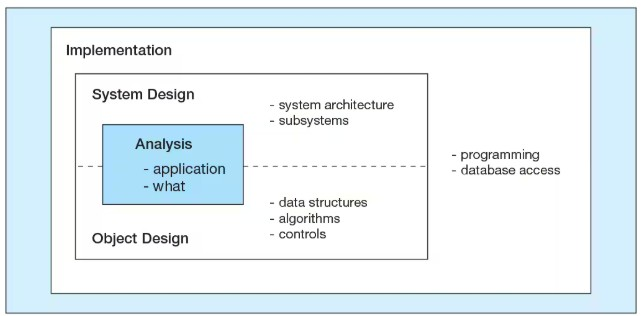

Figure 13-1: Phases of the object-oriented systems development cycle

In the analysis phase, you build a model of the real world application. The model abstracts concepts from the domain and describes what the system must do, not how it will be done. You focus on the real world domain, not the internals of the software system.

In the design phase, you define how the analysis model will be realized in the implementation environment. Your focus moves to modeling the software system itself. Jacobson and colleagues gave three reasons for this separate design step. First, the analysis model is not formal enough to move directly into code. Second, the system must be adapted to the real environment, with decisions about performance, concurrency, hardware, the DBMS, and the programming language. Third, design lets you validate the analysis. You can check whether the analysis results will actually support building the system and adjust accordingly in the next iteration.

Implementation follows design in each iteration. If design was done well, translating it into program code is fairly straightforward because the design model already reflects the programming language and DBMS choices.

Coad and Yourdon identified several benefits of the object-oriented approach. It lets us tackle more challenging problem domains. It improves communication among users, analysts, designers, and programmers. It creates consistency across analysis, design, and programming. It shows commonality explicitly. It makes systems more robust. It supports reuse of analysis, design, and programming results. And it keeps the models consistent with one another. That last point matters. In older approaches like structured analysis and design, the models were only weakly connected. The object-oriented approach gives you a smooth progression of representation from analysis to design to implementation.

## Unified Modeling Language

Unified Modeling Language, or UML, is a set of graphical notations backed by a common metamodel. It is widely used both for business modeling and for specifying, designing, and building software. UML came from the work of Grady Booch, Ivar Jacobson, and James Rumbaugh, who combined the best of the Booch, OOSE, and OMT methods. The current version is UML 2.5.1, maintained by the Object Management Group. UML helps us graphically depict object-oriented analysis and design, capture design decisions, and communicate with domain experts, users, and other stakeholders.

A complex system needs multiple views. UML gives us many diagram types for that purpose: use case diagrams, class diagrams, state machine diagrams, sequence diagrams, component diagrams, and deployment diagrams. Because this text is about databases, I focus on the class diagram, which is a static diagram that captures structural characteristics of the domain. Class diagrams also let us capture the responsibilities classes can perform, without specifying the behavior in detail.

## Object-Oriented Data Modeling

In this section I want you to get comfortable with the core building blocks: objects and classes, encapsulation of attributes and operations, associations, generalization, aggregation, cardinalities and other constraints, polymorphism, and inheritance. You will also learn to draw UML class diagrams.

## Representing Objects and Classes

A class is an entity type that has a well-defined role in the application domain. We care about its state, behavior, and identity. A class is a concept or abstraction that matters in context. It can be tangible, like a person, place, or thing. It can be a concept or event, like Department, Performance, or Registration. It can even be an artifact of the design process, like a User Interface or a Controller. An object is an instance of a class. A class of objects shares a common set of attributes and behaviors.

You may ask how this differs from entity types and instances in the E-R model. Entity types map to classes and entity instances map to objects. But an object does more than store information. It also exhibits behavior through operations that can examine or change its state.

The state of an object is made up of its properties (attributes and relationships) and the values those properties have. Its behavior is how it acts and reacts. The object's behavior depends on its current state and the operation being performed. An operation is an action the object performs in response to a request. I think of an operation as a service the object provides to its clients. A client sends a message, and the supplier executes the matching operation.

Take the Student class as an example. A particular object in this class might be Pat Jones. Pat's state is described by attributes like name, dateOfBirth, year, address, and phone. Pat's behavior shows up in operations like calcGpa for calculating the grade point average. Pat packages state and behavior together.

Every object has a persistent identity. No two objects are the same, even if they happen to share identical attribute values. An object also keeps its identity over its lifetime. If Pat Jones gets married and their name, address, and phone change, the object is still the same object.

Figure 13-2a shows how we draw classes in a class diagram. In UML, a class is a rectangle with three compartments. The class name sits at the top, the attributes in the middle, and the operations at the bottom. Figure 13-2b shows the matching object diagram, also called an instance diagram, which is a snapshot of the detailed state of the system at a point in time.

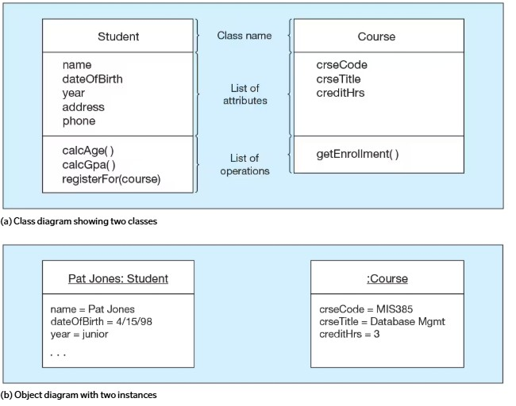

Figure 13-2: UML class and object diagrams

In an object diagram, an object is a rectangle with two compartments. The object name and class name are underlined at the top, separated by a colon. Attribute values appear in the second compartment. We can suppress attributes we do not care about. We can also suppress the object name, but we keep the colon with the class name in that case.

The object model supports multivalued, composite, derived, and other attribute types. The usual notation puts a stereotype label before the attribute name. For composite attributes, we can define a separate class and then declare an attribute of that type. For example, we could create an Address class made of street, city, state, and zip, and then declare stuAddress : Address inside Student. This is a powerful feature because it lets us reuse previously defined structures.

An operation is a function or service provided by all instances of a class. Other objects typically access or change the stored data only through operations. The operations form the external interface, while the internal details stay hidden. This idea of hiding internal details is called encapsulation, or information hiding.

One more thing to keep in mind. It is common to use UML class diagrams to build domain models that have no operations at all. These focus only on the structural side and look a lot like the conceptual data models you learned in Chapters 2 and 3. The operations shown in design diagrams usually describe software behavior, not real world behavior. In Figure 13-2, the three operations make sense for software objects but not as behaviors of real world students and courses.

## Types of Operations

Operations come in four flavors. A constructor operation creates a new object. An example would be a Student operation that creates a new student and sets up its initial state. These are available to all classes, so we usually do not show them explicitly in the diagram.

A query operation accesses the state of an object without changing it. A calcAge operation on Student is a query because it just returns information. In object-oriented programming, query methods that read an attribute are called getter methods, and they belong to the broader category of accessor methods.

An update operation changes the state of an object. A promoteStudent operation that moves a student from junior to senior changes the year attribute. A registerFor(course) operation establishes a connection from a Student object to a Course object. Explicit arguments go inside parentheses. Methods that change attribute values are called setter or mutator methods.

A class-scope operation applies to the class rather than to a single instance. An avgGpa operation that computes the average GPA across all students is an example. We underline the name of a class-scope operation to mark it.

## Representing Associations

An association is a named relationship between or among instances of object classes. Just like in the E-R model, associations can be unary, binary, ternary, or higher. An association is shown as a solid line between classes. The end of the line where it connects to a class is called an association role. Role names are optional. You can label the role with text near the end of the line. In Figure 13-3a, the manager role is labeled on the Manages relationship.

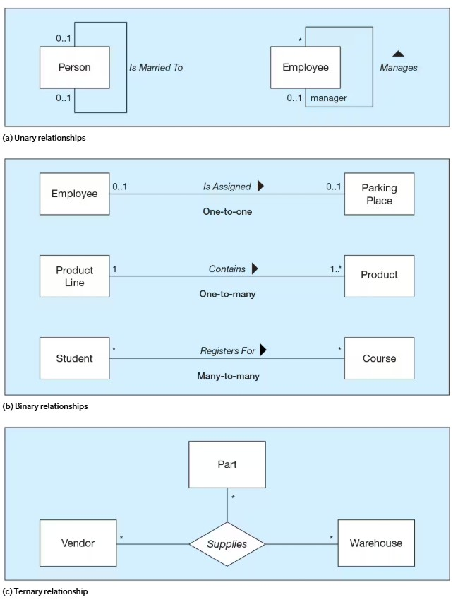

Figure 13-3: Examples of association relationships of different degrees

Each role has a multiplicity, which tells us how many objects can participate. In UML, we write multiplicities as lower bound two dots upper bound. For example, 2..5 means a minimum of two and a maximum of five. The upper bound can be a star (*) to mean no upper limit. A single integer means exactly that number. The three most common multiplicities are 0..1 (optional one), 0..* (optional many), and 1 (mandatory one, short for 1..1).

Figure 13-3a shows two unary relationships, Is Married To and Manages. A person may be married to zero or one other person. An employee may be managed by zero or one manager, but a manager may manage many employees.

Figure 13-3b shows three binary relationships. Is Assigned is one-to-one between Employee and Parking Place. An employee may or may not have a parking place, and a parking place may or may not be assigned. Contains is one-to-many between Product Line and Product. A product line contains at least one product, and each product belongs to exactly one product line. Registers For is many-to-many between Student and Course. A student may register for many courses or none, and a course may have many students or none.

Figure 13-3c shows a ternary relationship called Supplies among Vendor, Part, and Warehouse. As in E-R diagramming, we use a diamond and place the name inside. A ternary relationship cannot be replaced by three binary relationships without losing information.

Figure 13-4a shows binary associations among Student, Faculty, Course, and Course Offering. A student may have an advisor, and a faculty member may advise up to ten students. A course may have multiple offerings, but each offering is for exactly one course. A faculty member plays two roles here: instructor and advisor.

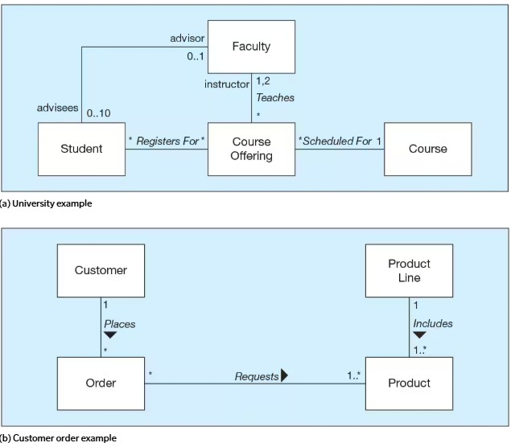

Figure 13-4: Examples of binary association relationships

Figure 13-5 shows the matching object diagram for the customer order example in Figure 13-4b. A link corresponds to an association, just as an object corresponds to a class. Joe placed two orders, Ord20 and Ord56. Ord20 contains product P93 from the sports line. Ord56 contains the same product plus P50 from the hardware line. Jane placed Ord45 with the same hardware product plus two cosmetics products, P9 and P10.

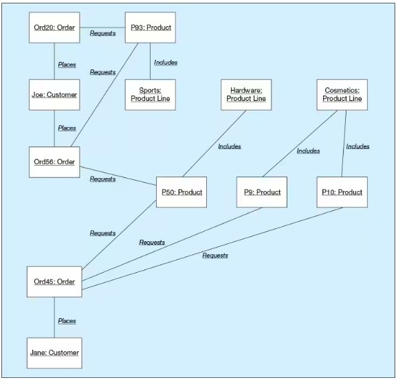

Figure 13-5: Object diagram for the customer order example

## Representing Association Classes

Sometimes an association has its own attributes or operations, or it participates in relationships with other classes. When that happens, we model the association as an association class, similar to the associative entity in Chapter 2. In Figure 13-6a, the attributes term and grade really belong to the many-to-many association between Student and Course. You cannot know a grade without knowing both the student and the course. The checkEligibility operation also belongs to the association. We have also captured that for some course registrations a computer account is issued. So Registration is modeled as an association class with its own features and its own association (Issues) with Computer Account.

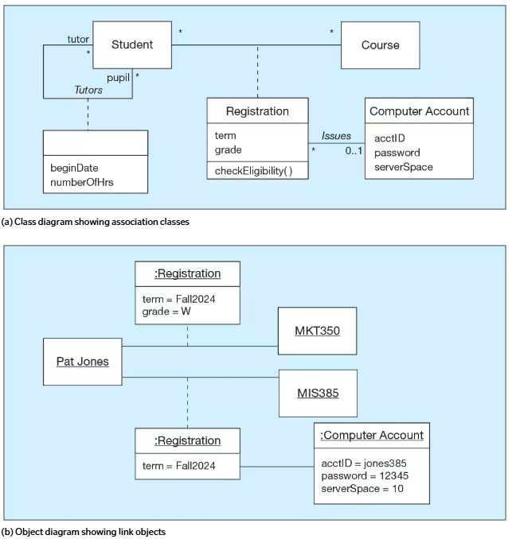

Figure 13-6: Association class and link object

You can show the name of an association class on the association path, on the class symbol, or both. If the association only has attributes and no operations or further associations, the common style is to put the name on the path and emphasize the association nature. If it has operations and its own relationships, putting the name in the class box emphasizes the class nature. Figure 13-6b is a partial object diagram showing Pat Jones registered for MKT350 and MIS385 in Fall 2024, with a computer account linked to the MIS385 registration.

Figure 13-7 shows a ternary relationship among Student, Software, and Course. It captures that students use software tools for specific courses. For example, Pat Jones might use Microsoft Access and Oracle for the Database Management course, Visio for Object-Oriented Modeling, and Eclipse for Application Development. To track usage details like beginDate, expiryDate, hoursLogged, and the estimateUsage operation, we attach an association class called Log to the ternary relationship.

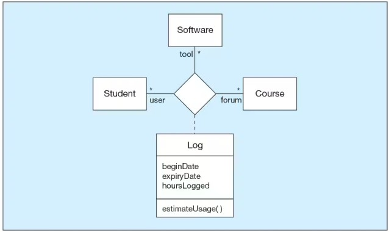

Figure 13-7: Ternary relationship with an association class

## Representing Derived Attributes, Associations, and Roles

A derived element can be computed from other elements in the model. We mark derived elements with a forward slash before the name. In Figure 13-8, age is a derived attribute of Student because it can be calculated from dateOfBirth and the current date. The calculation is shown in braces above the class. The Takes relationship between Student and Course is a derived association because it can be inferred from Registers For and Scheduled For. The participants role is also derived.

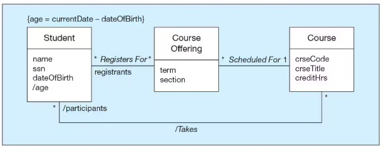

Figure 13-8: Derived attribute, association, and role

## Representing Generalization

You met generalization and specialization in Chapter 3. In EER, you abstracted common attributes and relationships into a supertype and kept the distinct ones in the subtypes. The object-oriented model extends this idea. When we generalize in design, we also abstract the common operations. Attributes and operations together are called the features of the class. The classes that are generalized are called subclasses. The class they generalize into is called the superclass. This parallels subtypes and supertypes in EER diagramming.

Figure 13-9a shows Employee as a superclass with three subclasses: Hourly Employee, Salaried Employee, and Consultant. The features common to all employees (empName, empNumber, address, dateHired, and printLabel) stay in Employee. The special ones go in the subclasses. For example, hourlyRate and computeWages belong to Hourly Employee. A generalization path is drawn as a solid line from the subclass toward the superclass, with a hollow triangle pointing toward the superclass. When multiple subclasses share a superclass, we can merge the paths into a tree, like Figure 13-9b.

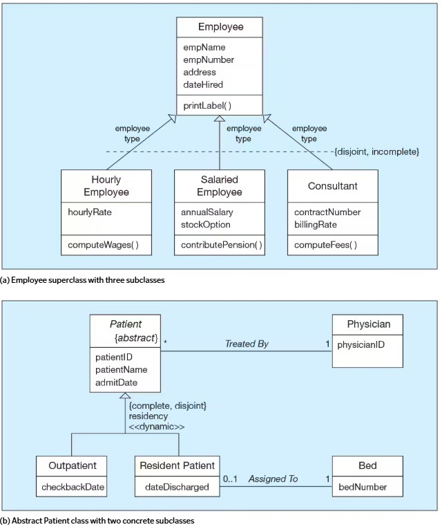

Figure 13-9: Examples of generalization, inheritance, and constraints

You can indicate what drives the generalization by labeling it with a discriminator. In Figure 13-9a, we discriminate Employee by employment type. In Figure 13-9b, we discriminate Patient by residency.

An instance of a subclass is also an instance of its superclass. This is why generalization is also called an is-a relationship. A subclass inherits all the features of its superclass. An Hourly Employee object has its own hourlyRate and computeWages plus all the inherited features from Employee. Generalization and inheritance are transitive across multiple levels. A Computer Consultant that inherits from Consultant also inherits from Employee.

Inheritance is one of the biggest advantages of the object-oriented model. It supports code reuse. You do not need to rewrite code that already exists in a superclass. You only write code that is unique to the new subclass. In practice, object-oriented developers work with large libraries of classes that they can reuse and refine. Proponents claim that reuse delivers productivity gains of several orders of magnitude.

In Figure 13-9b, the Patient class is shown in italics. That means it is an abstract class, a class with no direct instances of its own. Its descendants can have direct instances. A class that can have direct instances, like Outpatient or Resident Patient, is called a concrete class.

The Patient class participates in a Treated By relationship with Physician, so all patients are treated by physicians. The Resident Patient subclass also has its own Assigned To relationship with Bed. So a subclass can refine attributes, operations, and relationships.

UML uses keywords in braces to capture constraints among subclasses. Overlapping means a descendant may be descended from more than one subclass. Disjoint means a descendant may not. Complete means all subclasses are specified and no more are expected, which matches total specialization in EER. Incomplete means some subclasses are not yet in the model, which matches partial specialization. The valid combinations are {complete, disjoint}, {incomplete, disjoint}, {complete, overlapping}, and {incomplete, overlapping}.

The generalizations in Figure 13-9 are disjoint. An employee is hourly, salaried, or a consultant, but cannot be more than one at a time. Figure 13-9a is incomplete, so an employee might belong to none of the three subclasses. Figure 13-9b is complete, so a patient must be either outpatient or resident patient. That is why Patient is abstract.

Figure 13-10 gives a good example of an overlapping constraint. Research Assistant and Teaching Assistant are both subclasses of Graduate Student. Because the constraint is overlapping, a graduate student can hold both assistantships at once. Robin Bailey, for example, has a research assistantship of 12 hours per week and a teaching assistantship of 8 hours per week. Graduate Student is also a concrete class so we can represent graduate students who have no assistantship.

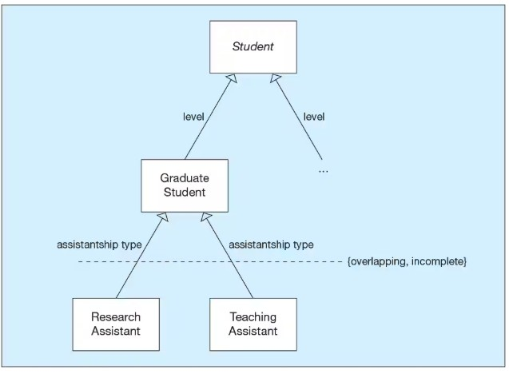

Figure 13-10: Example of an overlapping constraint

Figure 13-11 introduces a few more important ideas. The calcTuition operation depends on tuitionPerCred, the courses taken, and the credit hours. The tuitionPerCred attribute is underlined because it is a class-scope attribute, meaning all instances of the class share the same value ($3,200 for graduate students, $2,750 for undergraduates). A class-scope attribute forces every instance to share one value, while an initial default value (like creditHrs = 3) only sets the starting point and lets each instance differ later.

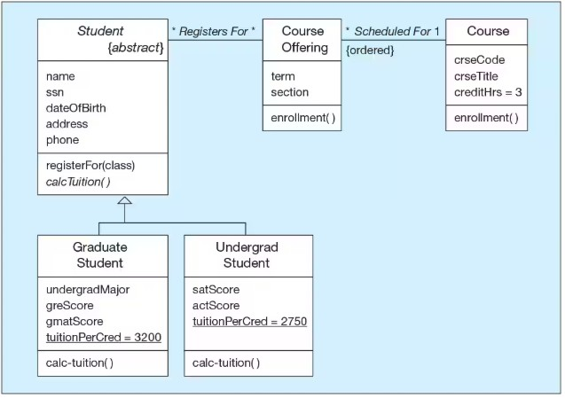

Figure 13-11: Polymorphism, abstract operation, class-scope attribute, and ordering

We also mark the ordering of roles when it matters. The {ordered} keyword next to Course Offering tells us the offerings for a course are kept in order, perhaps by term and section. The default is {unordered}. Ordering only makes sense when the multiplicity is greater than one.

The calcTuition operation in the Student class is shown in italics, so it is an abstract operation. It defines the protocol (arguments, return type, intended meaning) but not the implementation. The concrete subclasses Graduate Student and Undergrad Student provide their own versions. The fact that an operation with the same name can be implemented differently in different classes is polymorphism. The enrollment operation in the figure is another example. Inside Course Offering, it computes enrollment for one section. Inside Course, it computes the combined enrollment for all sections.

## Multiple Inheritance

So far we have looked at single inheritance, where a class inherits from one superclass. Sometimes an object is an instance of more than one class. That is called multiple classification. In the assistantship example, Robin Bailey would be both a Research Assistant and a Teaching Assistant. Experts generally discourage multiple classification, and many UML tools and object-oriented languages do not support it.

Multiple inheritance is the workaround. A class can inherit features from more than one superclass. In Figure 13-12, Research Teaching Assistant inherits from both Research Assistant and Teaching Assistant. Now we can represent Robin Bailey as one object of class Research Teaching Assistant, inheriting researchHrs and assignProject(proj) from one parent and teachingHrs and assignCourse(crse) from the other.

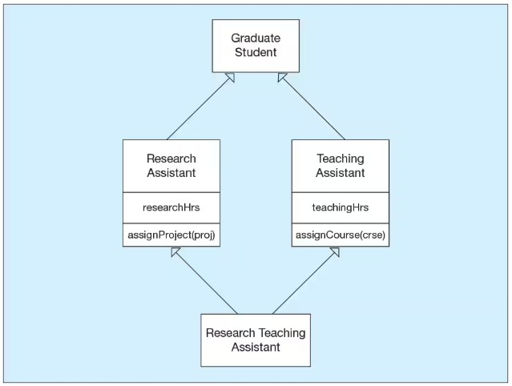

Figure 13-12: Multiple inheritance

## Representing Aggregation

Aggregation expresses a part-of relationship between a component and an aggregate. It is a stronger kind of association and gets a hollow diamond on the aggregate end. Figure 13-13 shows a Personal Computer as an aggregate of CPU, Hard Disk, Monitor, Keyboard, and other parts. A PC can have one to four CPUs, one or more hard disks, and exactly one monitor and keyboard. A component object can also exist without being part of a whole. A monitor might exist on its own outside any PC.

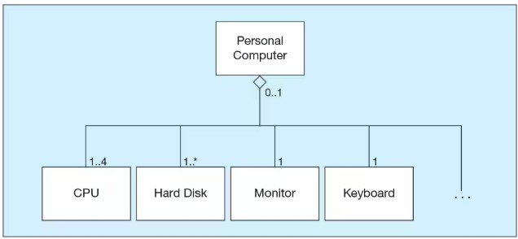

Figure 13-13: Example of aggregation

Aggregation and generalization are different. Aggregation involves distinct object instances where one contains others. Generalization involves classes, where one object is at the same time an instance of both its subclass and its superclass. Only one object is involved in a generalization relationship. That is why aggregation shows multiplicities on the ends but generalization does not.

Figure 13-14a shows a university aggregation structure. A university has administrative units and schools. Each school has departments. Figure 13-14b shows the matching object diagram for Riverside University, with Admissions, Human Resources, and the Business school, which has Accounting and Finance as its departments.

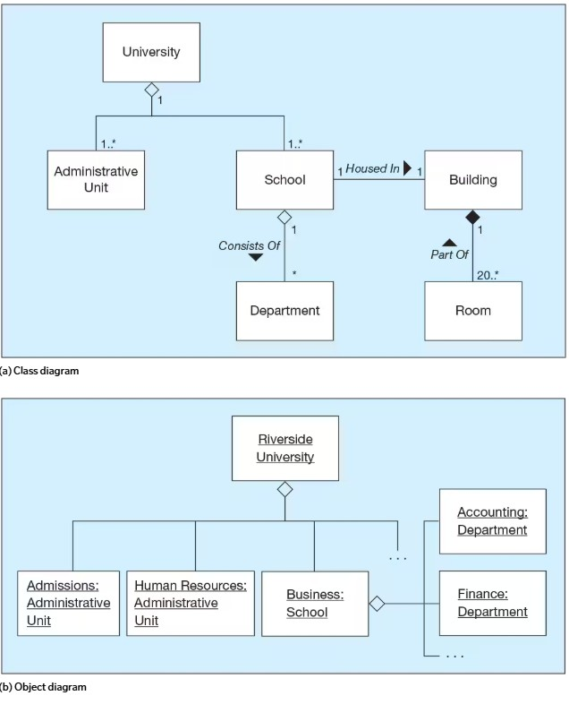

Figure 13-14: Aggregation and composition

Notice that the diamond between Building and Room is solid, not hollow. A solid diamond represents composition, which is a stronger form of aggregation. In composition, a part belongs to one and only one whole during its lifetime. A room is part of one building, cannot exist alone, and is destroyed when the building is destroyed. The multiplicity on the aggregate end is always exactly one. Parts can be added after the whole is created, but once added they live and die with the whole.

Figure 13-15 shows a recursive aggregation, the classic bill-of-materials structure. A product consists of many parts. Parts can themselves be assemblies of other parts. We model this with an abstract Part class and two concrete subclasses, Assembly and Simple Part. An Assembly is an aggregate of Part objects, which can be either other assemblies or simple parts. In the E-R model you could only represent this as a many-to-many unary association, but in the object-oriented model we can show the aggregation directly.

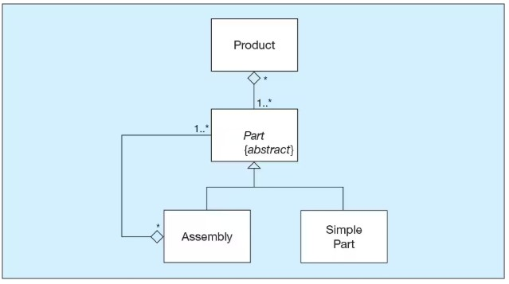

Figure 13-15: Recursive aggregation

When you are not sure whether something is an association or an aggregation, ask yourself if there is a whole-part relationship. Aggregation does not require physical containment. The relationship between a mutual fund and a stock in its portfolio is conceptual, not physical. In aggregation, the component can sometimes exist on its own and can belong to more than one aggregate. In composition, a component belongs to only one whole. Fowler advises caution with regular (non-composition) aggregation because in practice the difference from a plain association can be fuzzy. Follow your organization's conventions.

## Business Rules

Business rules were covered in detail in Chapters 2 and 3. You saw how to express them in E-R diagrams. In this chapter, we have already captured many business rules as constraints on classes, attributes, operations, and relationships. We used cardinality constraints, ordering constraints like {ordered}, and semantic constraints like {disjoint, complete}. Many rules are written as UML keywords in braces, placed near the elements they govern. If a rule cannot be expressed this way, you can state it in plain English or in formal logic.

When a business rule connects two graphical symbols, we can draw a dashed arrow between them and label it with the constraint name in braces. In Figure 13-16, the rule that a department chair must be a member of the department is shown by saying the Chair Of association is a {subset} of the Member Of association.

When a business rule involves three or more symbols, we use a note and attach it with dashed lines to each symbol. In Figure 13-16, the rule that a faculty member assigned to teach a section must be qualified to teach that course spans three associations. We attached the note to all three.

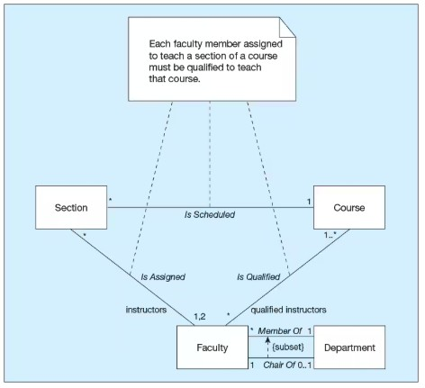

Figure 13-16: Representing business rules

## Object Modeling Example: Pine Valley Furniture Company

In Chapters 2 and 3, you built a high-level E-R diagram for Pine Valley Furniture. Now I want to walk you through the same application as an object-oriented class diagram so you can see what carries over and what changes. Figure 13-17 shows the result, drawn in Microsoft Visio. Many other tools support UML, from simple drawing tools to full model-driven development platforms.

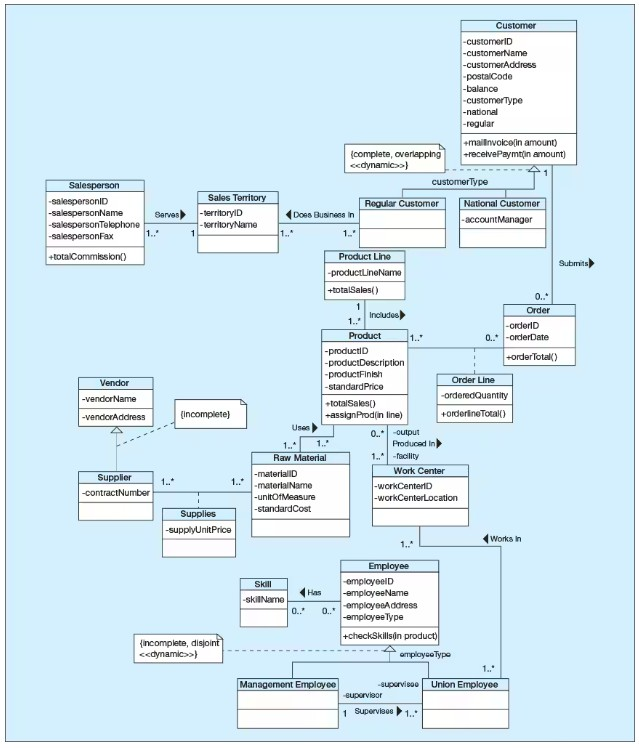

Figure 13-17: Class diagram for Pine Valley Furniture Company

As you would expect, the entity types become classes and the attributes sit inside the classes. Notice that we do not include explicit primary key identifiers. Every object has its own identity by definition, so we only show identifiers that have real business meaning, like customerID, salespersonID, orderID, and productID. There is no productLineID because Product Line ID was just an internal identifier in the E-R model, not something the business actually uses. Classes like Vendor, Order Line, and Skill have no identifier for the same reason.

Role names appear on some relationships. Product plays the role of output and Work Center plays the role of facility in the Produced-in relationship.

The class diagram shows operations that could not be captured in an E-R diagram. In practice, operations are often left out of business domain models during analysis, but I include them here to show how object-oriented design integrates data and behavior. The Customer class has mailInvoice, which sends an invoice to the customer for an order and increases the customer's outstanding balance. The receivePaymt operation adjusts the balance when payment arrives. The orderlineTotal operation in Order Line computes the total for one line of an order. The orderTotal operation in Order sums up all the lines for an order.

Figure 13-17 also shows polymorphism. The totalSales operation shows up in both Product and Product Line. In Product, it computes total sales for one product. In Product Line, it computes total sales across all products in that line. Same operation name, different implementations, different class contexts.

Several operations are query operations, including totalSales, totalCommission, orderTotal, orderlineTotal, and checkSkills. They return information without changing the state of any object. Other operations are update operations, including mailInvoice, receivePaymt, and assignProd. The assignProd operation, for instance, assigns a product to a product line, which changes the state of both the product and the product line.

## Closing Thoughts

I want you to take three things away from this chapter. First, object-oriented modeling extends what you already know from E-R and EER. Classes, associations, generalization, and aggregation have clear parallels with entity types, relationships, supertypes, and subtypes. The difference is that classes package behavior along with data, which lets us model complete systems in one consistent notation.

Second, UML class diagrams are the right tool for this kind of modeling. They give us a clean way to show structure, constraints, and responsibilities. They work for pure domain models that capture only structure, and they work for design models that include operations and refinement.

Third, the object-oriented approach gives us tools we did not have in E-R, including inheritance, polymorphism, encapsulation, aggregation, and composition. Inheritance and polymorphism support code reuse and cleaner designs. Aggregation and composition let us represent whole-part relationships directly rather than working around them with associations. These tools help us tackle bigger, more complex systems with less code and clearer communication across the team.
